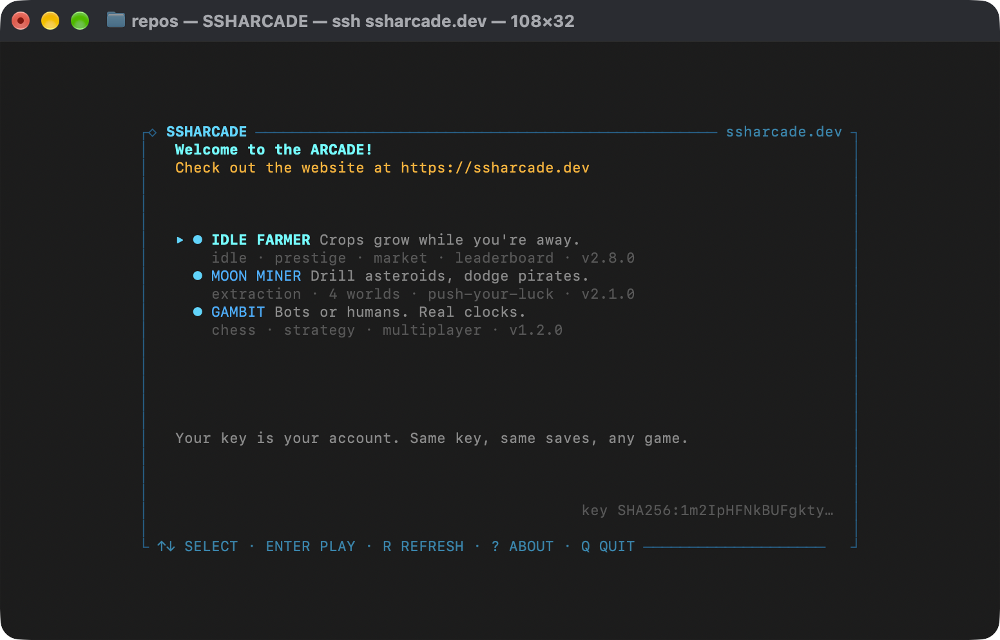
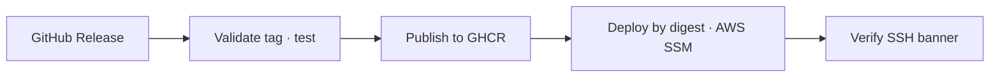
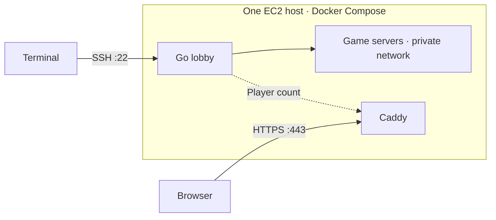

<h1 align="center">SSH Arcade Lobby</h1>

<p align="center">A fleet of terminal games behind one SSH address, shipped to a single EC2 host.</p>

<p align="center">
  <a href="https://github.com/MyNameIs-Nigel/ssh-arcadelobby/actions/workflows/ci.yml"></a>
  <a href="https://github.com/MyNameIs-Nigel/ssh-arcadelobby/actions/workflows/release.yml"></a>
  <a href="https://github.com/MyNameIs-Nigel/ssh-arcadelobby/actions/workflows/weekly-image-scan.yml"></a>
  <a href="https://github.com/MyNameIs-Nigel/ssh-arcadelobby/releases/latest"></a>
</p>

```sh
ssh ssharcade.dev
```

<p align="center">
  
</p>

<p align="center">
  <a href="https://www.ssharcade.dev">Website</a> ·
  <a href="https://github.com/MyNameIs-Nigel/ssh-farm">Idle Farmer</a> ·
  <a href="https://github.com/MyNameIs-Nigel/ssh-moonminer">Moon Miner</a> ·
  <a href="https://github.com/MyNameIs-Nigel/ssh-chess">GAMBIT</a> ·
  <a href="https://github.com/MyNameIs-Nigel/ssh-bulletin">Bulletin</a>
</p>

## From GitHub to EC2

> [!NOTE]
> Pushes to `main` run CI. Publishing a stable GitHub Release starts the production rollout.



GitHub Actions uses OIDC to get temporary AWS credentials. If the new router or its configuration fails, the deploy script restores the previous image and config.

[Release and rollback guide](docs/releasing.md) · [Successful rollout](https://github.com/MyNameIs-Nigel/ssh-arcadelobby/actions/runs/39320153040) · [Container image](https://github.com/MyNameIs-Nigel/ssh-arcadelobby/pkgs/container/ssh-arcadelobby)

## Inside the arcade



The lobby forwards your SSH key identity so you can pick up your saves. Each game deploys independently, and the lobby marks it offline if it goes down.

[Run the fleet locally](scripts/dev-local-fleet.sh) · [Fleet configuration](deploy/docker-compose.yml) · [Docs](docs/README.md) · [MIT license](LICENSE) · [Third-party notices](NOTICE)
